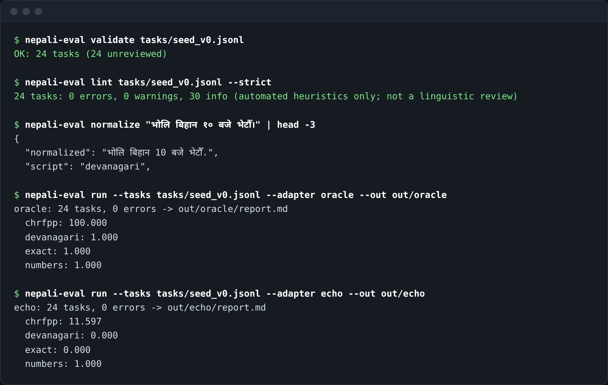

# nepali-eval

An offline-first, dependency-free **evaluation harness for Nepali-language AI outputs**.
It scores model answers the way a Nepali reader would reasonably accept them — ignoring
differences like `१०` vs `10` or `।` vs `.` — and keeps genuine spelling variants visible as
separate, reviewable references.

[नेपालीमा संक्षिप्त जानकारी](README.ne.md) (machine-assisted, not yet reviewed by a native speaker)

> **Status: v0.1, early.** The bundled 24 seed tasks only exercise the harness. They were written by
> the maintainers with AI assistance, are **unreviewed by native speakers**, and are **not a benchmark**.
> No model results are published here and none should be inferred. See [docs/METHODOLOGY.md](docs/METHODOLOGY.md) and
> [docs/REVIEW_GUIDE.md](docs/REVIEW_GUIDE.md) for what still needs native-speaker review.



*Real output of the commands shown. The `oracle` adapter returns the first reference (a ceiling check) and `echo` returns the prompt (a floor check); neither is a model result.*

## Why this exists
Existing Nepali work (for example Nep-gLUE, NLUE and cultural-commonsense sets) provides datasets for
understanding tasks, and projects such as the Nepali ASR/translation repository report BLEU/chrF++ from
notebooks. I did not find (search only; not proof of absence) a reusable harness that runs *any* model over
*generation/translation* tasks with Nepali-aware normalisation and a human-review loop. This tool is that
building block; it is meant to be pointed at community datasets that have clear licences, not to replace them.
Methodology and limitations: [docs/METHODOLOGY.md](docs/METHODOLOGY.md).

## Features
- JSONL task format with validation (`nepali-eval validate`): multiple acceptable references, tags,
  `license`, `source` and `review_status` are mandatory.
- Metrics: normalised exact match, chrF / chrF++ (own implementation, **checked against sacrebleu**), number
  preservation across digit systems, Devanagari share, pass/fail checks.
- Adapters: `oracle` (sanity), `echo` (baseline), `file:` (predictions you already have), `command:` (any local
  program via stdin/stdout, no shell), `openai` (any OpenAI-compatible endpoint, including local servers).
- Outputs: `results.json`, per-task `results.jsonl`, Markdown `report.md` (with limitations banner) and a
  `review.csv` for human scoring; `nepali-eval human` summarises it.
- Errors are never hidden: a failed prediction scores 0 and is counted.

## Install and use
Requires Python ≥ 3.10. No runtime dependencies.
```bash
git clone https://github.com/iamnarace/nepali-eval && cd nepali-eval
python -m venv .venv && . .venv/bin/activate
pip install -e ".[dev]"

nepali-eval validate tasks/seed_v0.jsonl
nepali-eval run --tasks tasks/seed_v0.jsonl --adapter oracle --out out/oracle     # should be perfect
nepali-eval run --tasks tasks/seed_v0.jsonl --adapter file:my_predictions.jsonl --out out/mymodel
# any OpenAI-compatible server (key is read from the NAMED env var, never from the command line):
export MY_KEY=...   # may incur cost; prompts are sent to that provider
nepali-eval run --tasks tasks/seed_v0.jsonl --adapter openai --base-url http://localhost:8080/v1 \
   --model my-model --api-key-env MY_KEY --out out/local
nepali-eval normalize "भोलि १० बजे।"
```
### Quality, review and interoperability commands
```bash
nepali-eval lint tasks/seed_v0.jsonl [--strict] [-v]      # automated heuristics (NOT a linguistic review)
nepali-eval export-review tasks/seed_v0.jsonl --out review.csv        # spreadsheet for native speakers
nepali-eval apply-review tasks/seed_v0.jsonl review.csv --out tasks/seed_v0.reviewed.jsonl
nepali-eval import-ndc accepted.jsonl --out tasks/from_ndc.jsonl --direction ne-en
```
`import-ndc` converts records from [nepali-data-commons](https://github.com/iamnarace/nepali-data-commons) into tasks
(format only; no shared code). Converted tasks stay `unreviewed` unless you pass `--trust-ndc-review`, because a
data-commons `accepted` status means a second person reviewed the record, not that a verified native speaker validated it.
See [docs/REVIEW_GUIDE.md](docs/REVIEW_GUIDE.md).

Predictions file: one JSON object per line, `{"id": "ne-en-001", "prediction": "..."}`.

Real output of the two sanity adapters on the seed tasks (these are *not* model results — they show the
oracle reaches the ceiling and an echo baseline does not):
```
oracle: 24 tasks, 0 errors   chrfpp: 100.000  exact: 1.000  numbers: 1.000  devanagari: 1.000
echo:   24 tasks, 0 errors   chrfpp:  11.598  exact: 0.000  numbers: 1.000  devanagari: 0.000
```
(`numbers` is 1.0 for echo because the prompt itself contains the numbers — see the methodology note.)

## Task format
```json
{"id":"ne-en-001","task_type":"translation_ne_en","prompt":"Translate into English...\nभोलि बिहान १० बजे भेटौँ।",
 "references":["Let's meet tomorrow morning at 10 o'clock.","Let's meet tomorrow at 10 AM."],
 "metrics":["chrfpp","exact","numbers"],"tags":["time","digits"],"checks":{"min_devanagari_ratio":0.9},
 "source":"original","license":"CC0-1.0","review_status":"unreviewed"}
```

## Development
```bash
ruff check . && python -m pytest -q       # 62 tests: sacrebleu parity, local HTTP server, lint, review round-trip, import
```
Layout: `src/nepali_eval/{normalize,metrics,tasks,adapters,runner,report,cli}.py`, `tasks/`, `tests/`, `docs/`.

## Data, licence, privacy
- Code: Apache-2.0 (see `LICENSE`, `NOTICE`). Seed tasks: CC0-1.0 (original text).
- The tool sends prompts only to the adapter you choose. Do not put private data in task files.
- If you add third-party data, record its licence and attribution in `source`/`license`; do not add data you
  may not redistribute.

## Known limitations
See [docs/METHODOLOGY.md](docs/METHODOLOGY.md): small unreviewed seed set; surface-overlap metrics; no
inter-annotator agreement yet; no dialect coverage claims; Latin script cannot separate English from Romanised Nepali.

## Roadmap
1. Native-speaker review of seed tasks; grow `reviewed` tasks. 2. Adapter/loader for licensed public datasets
(FLORES-style sets, after checking licences). 3. Agreement statistics for human review. 4. Speech (WER/CER) and
OCR tasks. 5. Optional embedding-based metrics behind an extra.

## Contributing
Start with [CONTRIBUTING.md](CONTRIBUTING.md) — correcting a task needs no code.

## Acknowledgements
Developed with assistance from Claude. chrF: Popović (2015); chrF++: Popović (2017); verified against
[sacrebleu](https://github.com/mjpost/sacrebleu) (Apache-2.0, dev-only). No endorsement by any Nepali
open-source organisation is implied.
